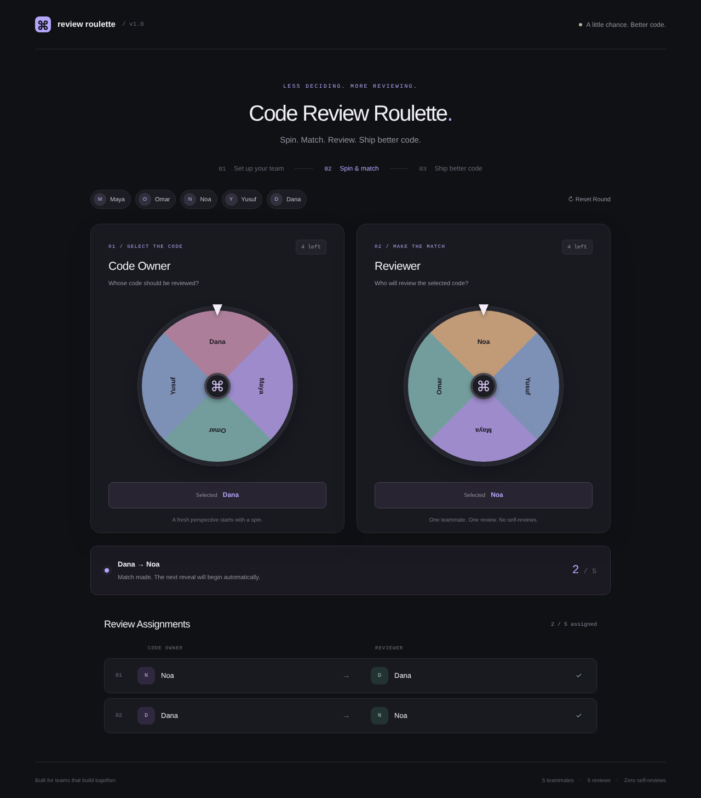
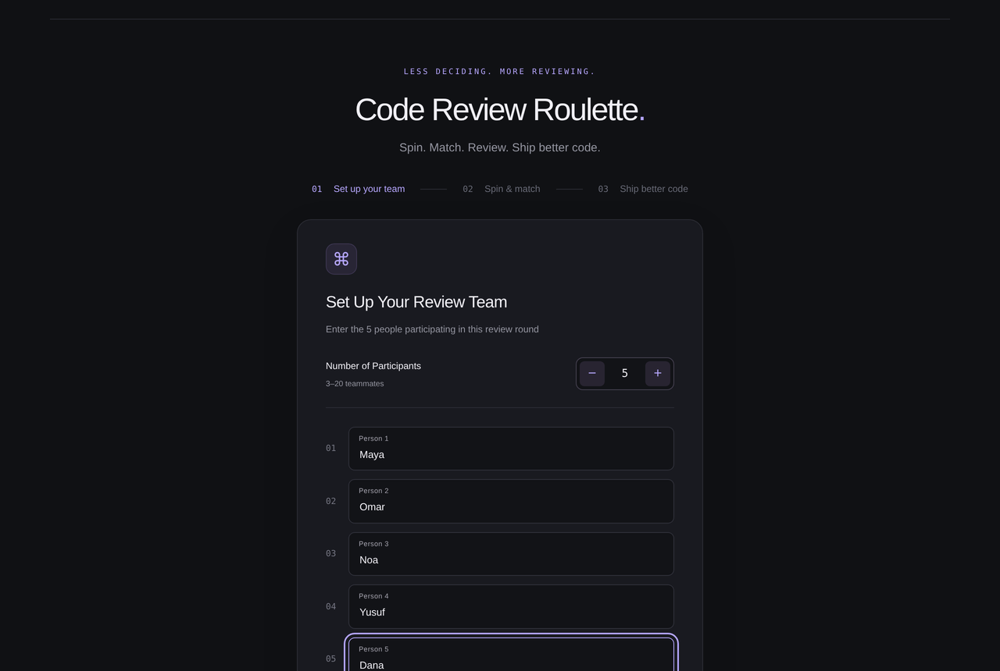
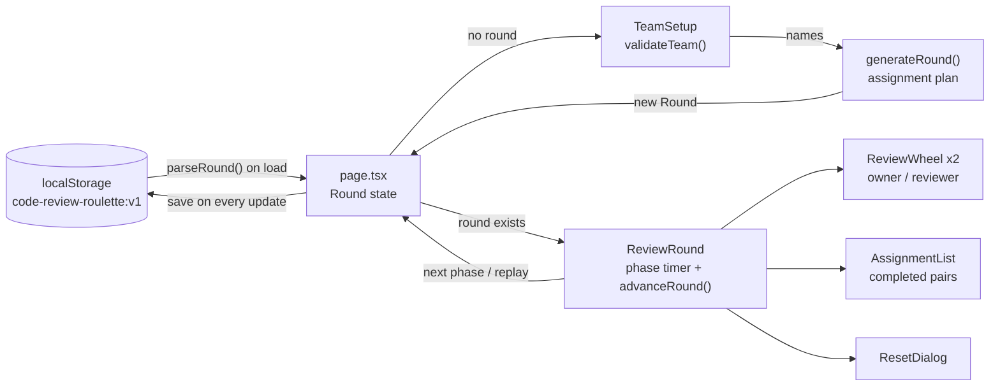

# Code Review Roulette

Fair, random code-review pairing for teams of 3 to 20: everyone reviews exactly one teammate, everyone gets reviewed once, and nobody reviews their own code.

**Live demo:** [code-review-roulette-five.vercel.app](https://code-review-roulette-five.vercel.app)



## Problem → Solution

Picking reviewers by hand is slow and tends to pair the same people again and again, and a naive random draw can leave the last person with only themselves to review. Code Review Roulette computes a complete, valid assignment plan before anything moves. Two animated wheels then reveal that plan one pair at a time, so the draw always finishes and never dead-ends. It runs entirely in the browser: no accounts, no backend, no environment variables.

## Features

- **Team setup** for 3 to 20 people (5 by default), with a stepper and validation that rejects blank and duplicate names. Duplicate checks trim whitespace and ignore case.
- **Automatic two-wheel reveal.** The owner wheel spins, then the reviewer wheel spins, until every pair is shown. Each wheel lands on the segment of the selected name.
- **Shrinking pools.** Assigned owners and reviewers drop off their own wheel, and the current owner is hidden from the reviewer wheel.
- **Live results list** of owner → reviewer pairs with initials avatars.
- **Replay With Same Team** draws a new mapping that is guaranteed to differ from the last one. **Start New Round** returns to an empty setup.
- **Reset confirmation** in a native `<dialog>`. The draw pauses while it is open.
- **Refresh recovery** through `localStorage`, with a visible notice if storage is unavailable.
- **Accessibility:** `aria-live` status updates, labelled wheels and controls, and `prefers-reduced-motion` support.



## Tech Stack

| Area      | Technology                                                       |
| --------- | ---------------------------------------------------------------- |
| Framework | Next.js 16 (App Router), React 19                                |
| Language  | TypeScript (strict)                                              |
| Styling   | Tailwind CSS 4 via PostCSS, custom CSS with `conic-gradient` wheels |
| Testing   | Node.js built-in test runner (`node:test`) run with `tsx`        |
| Linting   | ESLint 9 with `eslint-config-next`                               |
| Hosting   | Vercel                                                           |

## Architecture

`page.tsx` owns the single `Round` state object (`team`, `plan`, `completed`, `phase`) and saves it to `localStorage` on every change. The components only render that state or report changes back up.



## Engineering Decisions

- **Plan generated up front.** `generateDerangement()` in [`src/lib/assignment.ts`](src/lib/assignment.ts) builds the whole mapping before the first spin, so the wheels only animate a result that is already valid.
- **Derangement, no self-review.** The team is shuffled with Fisher-Yates and paired by position. A shuffle is accepted only if nobody got themselves and, on replay, the mapping differs from the previous one. This takes about e (~2.7) tries on average and is capped at 128.
- **Bounded fallback.** If sampling fails, the code tries cyclic shifts (person `i` reviewed by person `i + k`). Every shift is a valid derangement, so the round always completes, even with a broken random source. The reveal order is shuffled separately from the mapping.
- **Pure state machine.** `advanceRound()` is a pure function: `idle → owner-spinning → owner-selected → reviewer-spinning → reviewer-selected → between-assignments → …` until `complete`. One `setTimeout` in `ReviewRound` drives it and is cleared whenever the round changes, the round is complete, or the reset dialog is open.
- **Saved state is validated, not trusted.** [`src/lib/storage.ts`](src/lib/storage.ts) checks the team, confirms the plan is a valid derangement, checks that completed pairs match the start of the plan, and checks that the phase is consistent. Invalid data is removed. After a refresh, completed results are kept and the unfinished pair restarts from `idle`. An older saved format (`status` / `selectedOwner`) is converted.

## Testing

`src/lib/assignment.test.ts` has 8 tests, and all 8 pass (`npm test`). They cover:

- 10,000 full automatic rounds at team sizes 3, 4, 5, 10 and 20, checking valid derangements, that each owner and reviewer appears exactly once, and phase progression
- rejection of teams that are too small, too large, blank or duplicate
- replay always producing a fresh, valid mapping with progress cleared
- safe refresh from every phase, plus rejection of malformed or inconsistent saved state
- migration of the older saved format
- wheel landing angles for every segment at every team size
- the bounded fallback when `Math.random` returns a constant

`npm run lint` and `npm run build` also pass. The tests cover the logic in `src/lib`, not UI components.

## Getting Started

Requires Node.js 20.9 or later (the minimum for Next.js 16) and npm.

```sh
npm ci            # install dependencies
npm run dev       # start dev server at http://localhost:3000
npm test          # run unit tests
npm run lint      # run ESLint
npm run build     # production build (next build --webpack)
npm start         # serve the production build
```

## Project Structure

```
src/
├── app/
│   ├── page.tsx            # Round state, localStorage restore/save
│   ├── layout.tsx          # Root layout and metadata
│   └── globals.css         # Theme, wheel animations, reduced-motion rules
├── components/
│   ├── TeamSetup.tsx       # Participant count and validated name entry
│   ├── ReviewRound.tsx     # Phase timer, wheel pools, status, replay/reset
│   ├── ReviewWheel.tsx     # Conic-gradient wheel with computed landing angle
│   ├── AssignmentList.tsx  # Completed owner → reviewer pairs
│   └── ResetDialog.tsx     # Native <dialog> reset confirmation
└── lib/
    ├── assignment.ts       # Validation, derangement, state machine, constants
    ├── storage.ts          # Saved-state validation and migration
    └── assignment.test.ts  # Unit tests (node:test)
docs/screenshots/           # README screenshots
AGENTS.md, CLAUDE.md        # Instructions for the AI coding agent
```

## Built with an AI-Assisted Workflow

I built this project with an AI-assisted development workflow, using [Claude Code](https://claude.com/claude-code) as a coding assistant. `AGENTS.md` and `CLAUDE.md` hold the repo instructions the agent follows. The app has no AI features: assignments come from the plain TypeScript algorithm above, and the unit tests check that it is correct.

## Author

**Ward Keadan**

- Portfolio: [wardkeadan.vercel.app](https://wardkeadan.vercel.app)
- GitHub: [@wardkadan1](https://github.com/wardkadan1)
